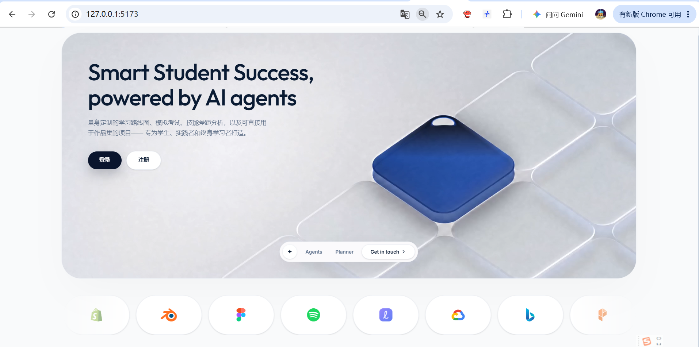
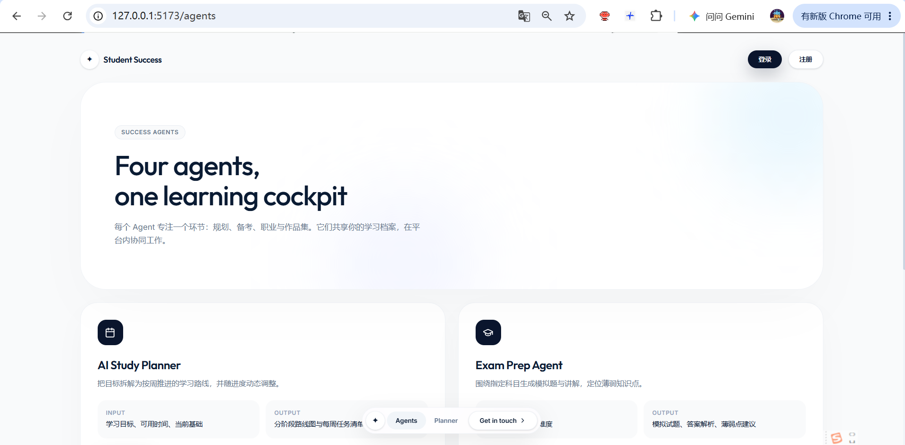
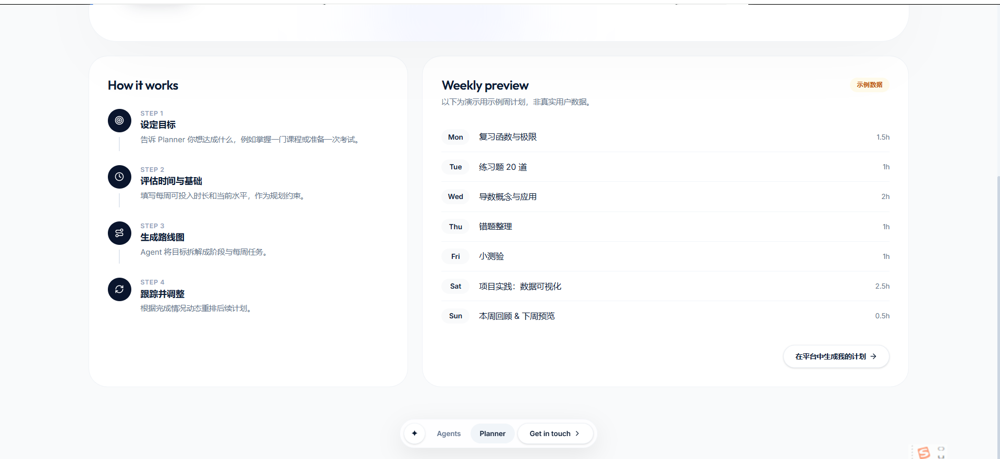

# Smart Student Success Agent

面向学生、实践者和终身学习者的人工智能学习与职业发展助手。

项目通过多个协作式智能代理，为用户提供学习计划、考试备考、职业规划和作品集项目推荐。系统采用前后端分离架构，AI 能力通过国内大模型 API 接入（DeepSeek、通义千问、智谱 GLM、Kimi、硅基流动等 OpenAI 兼容接口），服务商、密钥与模型均可在应用内配置。

[](#)
[](#)
[](#)
[](#)

## 界面预览

### 首页



### 智能代理介绍



### 学习计划展示



## 项目简介

许多学生在学习规划、考试复习和职业方向选择上面临困难，常见问题包括：

- 缺少个性化、可执行的学习计划
- 不清楚自己的知识薄弱点
- 难以判断目标岗位所需技能
- 不知道如何将学习成果整理为作品集
- 在海量学习资源中难以选择合适的路径

Smart Student Success Agent 将学习规划、备考、职业指导和项目实践整合到一个平台中，帮助用户把长期目标拆解为可执行、可跟踪的阶段任务。

## 核心功能

### 学习计划智能代理

- 根据科目、考试日期和每日可用时长生成学习计划
- 按周拆解学习目标与每日任务
- 优先安排薄弱主题
- 支持任务完成状态与学习进度跟踪
- 生成阶段里程碑和考前准备清单

### 考试备考智能代理

- 生成结构化知识总结
- 提供重点问题及参考答案
- 自动生成选择题练习
- 给出选项解析和知识点说明
- 生成考前复习任务清单

### 职业指导智能代理

- 根据目标职业分析技能差距
- 输出分阶段成长路线
- 推荐学习资源和技术方向
- 提供实习、岗位与作品集建议
- 展示招聘需求较活跃的行业方向

### 项目推荐智能代理

- 根据技术栈、项目领域和难度推荐作品集项目
- 生成项目功能规划与实施里程碑
- 提供项目说明和技术选型建议
- 生成可直接用于 GitHub 的 README 模板
- 支持一键复制项目模板

### 学习进度仪表盘

- 汇总学习时长、任务完成率和测验成绩
- 展示每周计划与实际完成情况
- 提供学习稳定性、专注度和最佳周次指标
- 根据当前进度给出下一步学习建议

### 智能聊天助手

- 在应用内提供持续可用的学习与职业咨询
- 结合当前学习科目和职业目标给出建议
- 支持推荐问题和连续对话
- 未配置密钥时给出明确提示，而非伪造回复

## 技术栈

| 模块 | 技术 |
| --- | --- |
| 前端 | React、Vite、Tailwind CSS、Motion、Lucide Icons |
| 后端 | FastAPI、Python、Pydantic |
| AI 服务 | 国内大模型 API（DeepSeek / 通义千问 / 智谱 GLM / Kimi / 硅基流动，OpenAI 兼容） |
| 数据校验 | Pydantic |
| 测试 | Pytest |
| 前端部署 | Vercel |
| 后端部署 | Render |
| 版本管理 | Git、GitHub |

## 系统架构

```text
React + Vite 前端
        │
        │ HTTP / JSON
        ▼
FastAPI 后端
        │
        ├── 学习计划智能代理
        ├── 考试备考智能代理
        ├── 职业指导智能代理
        ├── 项目推荐智能代理
        └── 聊天助手
        │
        ▼
国内大模型 API（OpenAI 兼容）
```

前端负责页面交互、导航、表单和结果展示；后端负责请求校验、提示词组织、AI 调用和结构化响应处理。未配置密钥或调用失败时，后端返回明确的错误信息；仅当后端服务完全无法访问时，前端才使用本地演示数据维持界面展示。

## 项目结构

```text
Smart-Student-Success-Agent/
├── backend/
│   ├── app/
│   │   ├── agents/          # 学习、备考、职业、项目与聊天代理
│   │   ├── main.py          # FastAPI 入口与接口定义
│   │   ├── models.py        # Pydantic 数据结构
│   │   └── config.py        # 环境变量配置
│   ├── tests/               # 后端自动化测试
│   ├── .env.example         # 环境变量示例
│   └── requirements.txt     # Python 依赖
├── frontend/
│   ├── src/
│   │   ├── components/      # 导航、顶部栏、聊天助手等组件
│   │   ├── pages/           # 各业务页面
│   │   ├── routes/          # 路由与访问控制
│   │   └── services/        # 后端接口与离线演示逻辑
│   └── package.json
├── screenshots/             # README 截图
└── README.md
```

## 后端接口

| 方法 | 接口 | 功能 |
| --- | --- | --- |
| GET | `/` | 后端运行状态 |
| GET | `/docs` | Swagger 接口文档 |
| GET | `/api/ai-status` | 查询后端是否已配置模型密钥 |
| POST | `/api/ai-test` | 用一次极短请求测试模型连接 |
| POST | `/api/planner` | 生成学习计划 |
| POST | `/api/exam-prep` | 生成备考资料与测验 |
| POST | `/api/career` | 生成职业能力分析与路线 |
| POST | `/api/projects` | 生成作品集项目建议 |
| POST | `/api/chat` | 智能聊天助手 |

## 本地运行

### 环境要求

- Python 3.10 及以上版本
- Node.js 20.19+ 或 22.12+，并安装 npm
- 可用的国内大模型 API Key，可选；未配置时无法生成内容（可浏览界面）

### 1. 启动后端

```bash
cd backend
python -m venv .venv
```

Windows：

```powershell
.\.venv\Scripts\Activate.ps1
pip install -r requirements.txt
```

macOS / Linux：

```bash
source .venv/bin/activate
pip install -r requirements.txt
```

复制环境变量示例并填写模型配置：

```bash
cp .env.example .env
```

```env
AI_API_KEY=your_api_key_here
AI_BASE_URL=https://api.deepseek.com/v1
AI_MODEL=deepseek-chat
PORT=8000
ENV=development
```

其他国内服务商只需替换 `AI_BASE_URL` 与 `AI_MODEL`：

| 服务商 | AI_BASE_URL | AI_MODEL |
| --- | --- | --- |
| DeepSeek | `https://api.deepseek.com/v1` | `deepseek-chat` |
| 通义千问（阿里云百炼） | `https://dashscope.aliyuncs.com/compatible-mode/v1` | `qwen-plus` |
| 智谱 GLM | `https://open.bigmodel.cn/api/paas/v4` | `glm-4-flash` |
| Kimi（月之暗面） | `https://api.moonshot.cn/v1` | `moonshot-v1-8k` |
| 硅基流动 | `https://api.siliconflow.cn/v1` | `deepseek-ai/DeepSeek-V3` |

旧版 `DEEPSEEK_API_KEY` / `DEEPSEEK_BASE_URL` / `DEEPSEEK_MODEL` 变量名仍然兼容。

启动 FastAPI：

```bash
uvicorn app.main:app --reload --port 8000
```

- 后端地址：`http://localhost:8000`
- 接口文档：`http://localhost:8000/docs`

### 2. 启动前端

```bash
cd frontend
npm install
npm run dev
```

打开 `http://localhost:5173` 即可访问系统。

## 密钥配置与回退策略

API Key 不是启动项目的强制条件，但只有配置密钥后才能得到真实的模型生成结果。

- 配置有效密钥：调用所选国内大模型 API 生成个性化内容
- 未配置密钥：后端返回 400，前端提示前往设置页配置
- AI 接口调用失败：后端返回 502，并附带服务商返回的错误信息
- 后端不可访问：前端使用本地演示数据继续展示界面（仅用于预览）
- 需要旧版演示回退：设置 `ALLOW_DEMO_FALLBACK=true`，调用失败时返回内置演示数据

密钥有两种配置方式：

1. 应用内「设置」页面（适合个人使用）：选择服务商并填写密钥、接口地址和模型，保存在浏览器 localStorage，通过 `X-AI-Api-Key` / `X-AI-Base-Url` / `X-AI-Model` 请求头传给后端
2. 后端 `.env` 文件（适合部署环境）：设置 `AI_API_KEY`、`AI_BASE_URL`、`AI_MODEL`

## 测试

后端包含接口测试和智能代理测试：

```bash
cd backend
pytest -q
```

当前测试覆盖：

- FastAPI 基础与业务接口
- 学习计划生成
- 考前资料与选择题生成
- 职业指导生成
- 项目推荐生成
- 聊天助手
- 未配置密钥时的明确报错
- 请求头中的厂商配置透传
- 结构化 JSON 解析与校验失败重试

## 部署

### 后端部署到 Render

1. 在 Render 创建 Web Service。
2. 选择 Python 环境。
3. 构建命令：

```bash
pip install -r requirements.txt
```

4. 启动命令：

```bash
uvicorn app.main:app --host 0.0.0.0 --port $PORT
```

5. 配置环境变量：

```env
AI_API_KEY=your_api_key_here
AI_BASE_URL=https://api.deepseek.com/v1
AI_MODEL=deepseek-chat
ENV=production
```

### 前端部署到 Vercel

将 `frontend` 目录导入 Vercel，构建命令使用：

```bash
npm run build
```

输出目录：

```text
dist
```

生产环境建议通过 `VITE_API_URL` 配置后端地址。

## 安全说明

- 不要在代码仓库中提交真实 API Key
- 生产环境优先通过后端环境变量保存大模型密钥
- `.env`、缓存、日志和本地虚拟环境已加入 `.gitignore`
- 浏览器端保存的个人资料仅用于演示和本地状态恢复
- 部署到公网前应限制后端 CORS 来源并增加请求频率限制

## 项目定位

本项目是一个面向教育与职业发展的多智能体应用示例，重点展示：

- 前后端分离架构
- 多智能体任务拆分
- 国内大模型 API 接入（OpenAI 兼容多厂商）
- 结构化 AI 输出
- 前端路由与状态管理
- 明确的错误提示与可选演示降级
- 自动化接口测试

## 许可证

本项目用于学习、课程展示与作品集演示。
